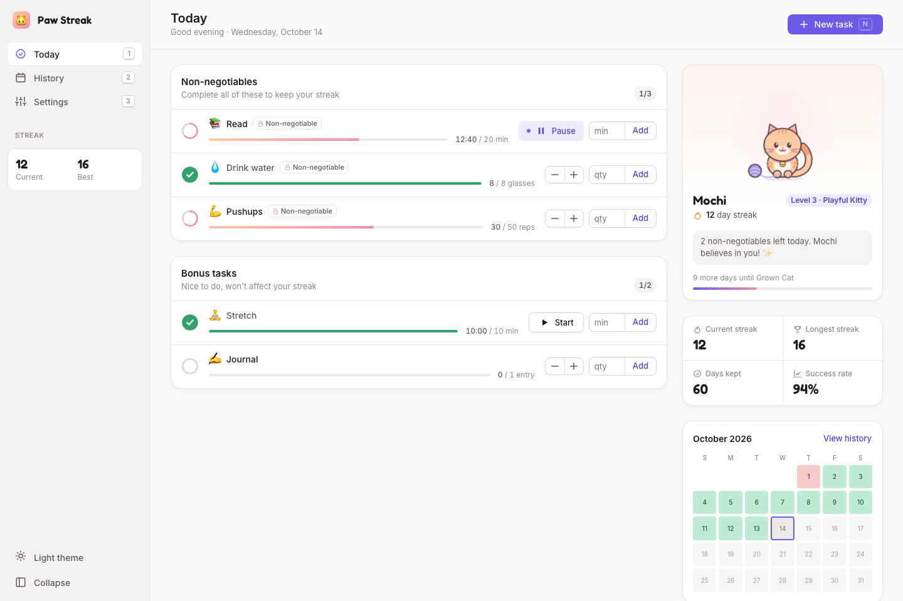
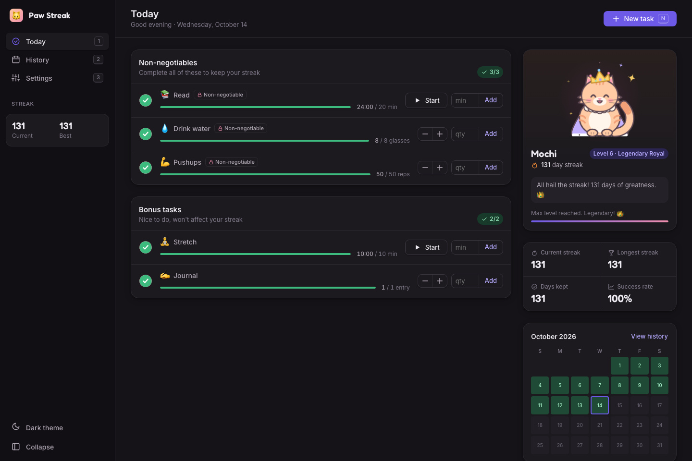
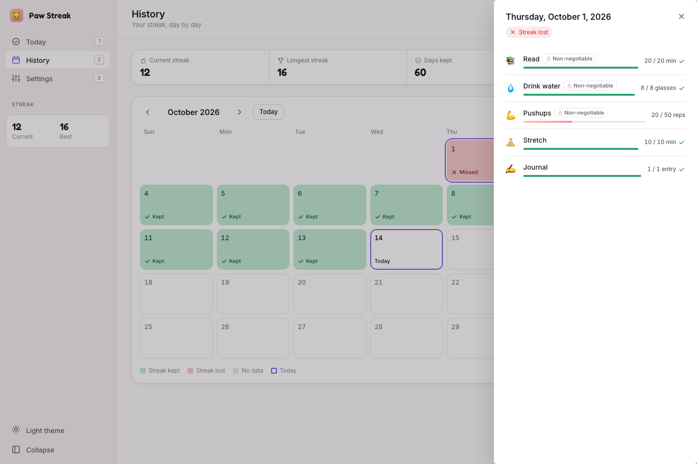
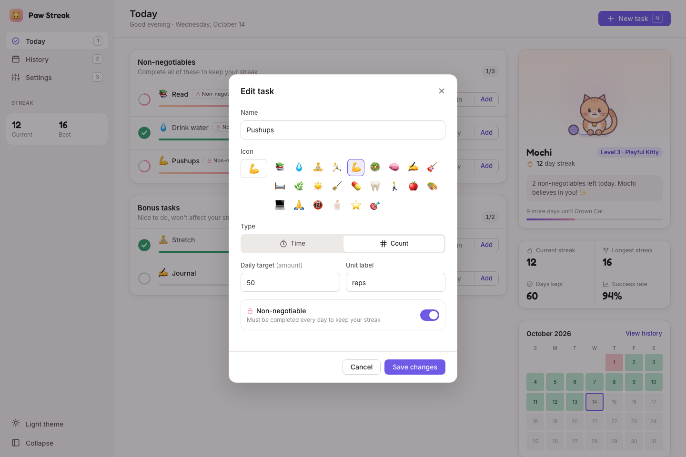
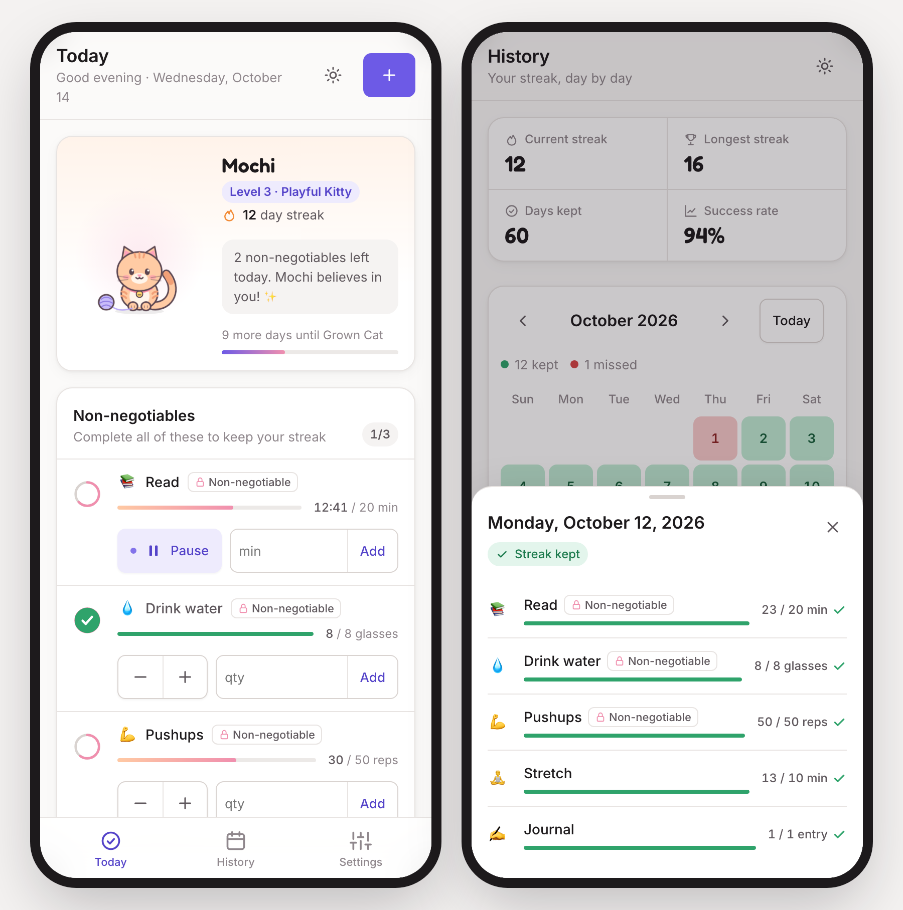
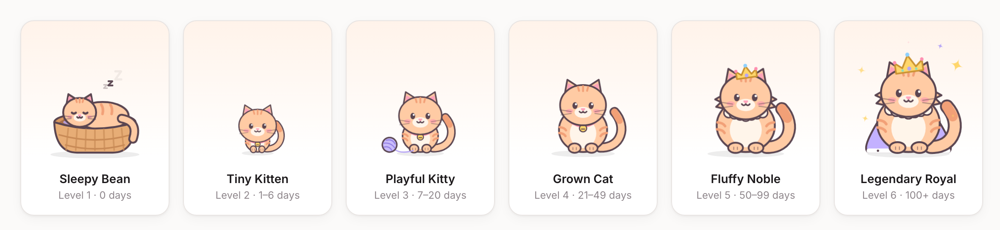
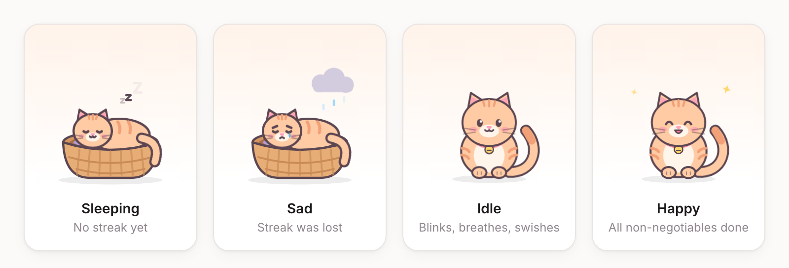

# 🐱 Paw Streak

**A daily habit tracker where a little cat grows with your streak.**

Paw Streak is a to-do tracker built around *non-negotiables*: the few things you promise yourself you'll do every single day. Finish all of them and your streak goes up. Miss one and it resets to zero. Your cat, Mochi, starts as a sleepy kitten in a basket and grows into a crowned, sparkling royal cat as your streak gets longer.

**[▶ Open the live app](https://habit-tracker-7jp3.vercel.app)**



---

## Contents

- [What it does](#what-it-does)
- [Screenshots](#screenshots)
- [How it works](#how-it-works)
  - [Tasks: time and count](#tasks-time-and-count)
  - [Non-negotiables vs. bonus tasks](#non-negotiables-vs-bonus-tasks)
  - [Streak rules](#streak-rules)
  - [The growing cat](#the-growing-cat)
  - [History calendar](#history-calendar)
  - [Settings](#settings)
- [Keyboard shortcuts](#keyboard-shortcuts)
- [Your data and privacy](#your-data-and-privacy)
- [Running it yourself](#running-it-yourself)
- [Tech details](#tech-details)
- [FAQ](#faq)

---

## What it does

| | |
|---|---|
| ✅ **Daily task list** | Track habits that are measured in **minutes** (Read for 20 min) or as a **count** (8 glasses of water, 50 pushups). |
| 🔒 **Non-negotiables** | Mark your must-do habits. A day only counts if *all* of them are finished. |
| 🔥 **Streaks** | See your current streak and your longest streak ever. Missed days, including days you didn't open the app, reset the streak. |
| 🐱 **A cat that grows** | Six growth stages from "Sleepy Bean" to "Legendary Royal". The cat reacts when you finish tasks and looks sad if you lose your streak. |
| 📅 **History calendar** | A month view coloured green (streak kept) or red (streak lost). Click any day to see exactly what you did. |
| 🌗 **Light and dark mode** | Follows your system setting by default, or pick one yourself. |
| 📱 **Works everywhere** | Sidebar layout on desktop, icon rail on tablet, bottom tab bar on phones. |
| 🔐 **Private by design** | No account, no server, no tracking. Everything stays in your browser. |

---

## Screenshots

### Today (desktop)

The main dashboard. Tasks are on the left, grouped into **Non-negotiables** and **Bonus tasks**. Each row has a progress ring that turns into a green check when the task is done, a progress bar, and quick controls. The right panel shows your cat, your streak stats, and this month at a glance.


### Dark mode, at the top level

After 100+ full days (1,000 XP) your cat becomes a **Legendary Royal** with a crown, cape and sparkles. When every non-negotiable is done for the day, the cat celebrates and confetti falls.



### History

A full-month calendar. Green days kept the streak, red days lost it, and today is outlined. Clicking a day opens a side panel showing each task's progress against its target for that day.



### Adding or editing a task

Pick a name, an icon, the type (Time or Count), a daily target, and whether it's a non-negotiable.



### On your phone

Single-column layout with a bottom tab bar and large tap targets. Dialogs and day details slide up as bottom sheets.



---

## How it works

### Tasks: time and count

Every task is one of two types:

| Type | Example | How you log progress | Done when |
|---|---|---|---|
| ⏱️ **Time** | Read – 20 min | Press **Start** to run a built-in timer, **Pause** to stop it, or type minutes into the box and press **Add**. | The minutes reach the target. |
| 🔢 **Count** | Drink water – 8 glasses | Tap **−** / **+**, or type an amount into the box and press **Add**. | The count reaches the target. |

A few details:

- **The timer keeps going if you close the tab.** It remembers when you pressed Start, so coming back later shows the right time.
- **Only one timer runs at a time.** Starting a second task's timer pauses the first.
- **You can fix mistakes.** Type a negative number (like `-5`) into the Add box to subtract.
- **You can go over your target.** Reading 30 minutes on a 20-minute goal is fine and is saved in your history.

### Non-negotiables vs. bonus tasks

- 🔒 **Non-negotiables** are your daily must-dos. They are the *only* tasks that decide whether your streak survives.
- 🌸 **Bonus tasks** are nice-to-haves. Track them for your own satisfaction; they never affect your streak.

You can switch a task between the two at any time in **Settings**.

### Streak rules

1. A day is a **success** only if **every** non-negotiable reaches its target that day.
2. Each successful day in a row adds **1** to your streak.
3. If a day ends with **any** non-negotiable unfinished, the streak goes back to **0**.
4. Days you **didn't open the app** count as missed. When you come back, the app fills in those days as red.
5. **Today counts as soon as you finish.** The moment your last non-negotiable is done, your streak goes up and the cat may grow right away. Today can't *break* your streak until midnight.
6. Progress **resets at midnight** (your local time). Yesterday's results are saved to your history first.
7. You need **at least one non-negotiable** for a day to count. An empty list can't build a streak.

Your **longest streak** is remembered separately, so a reset never erases your record.

### The growing cat

Your cat grows with **XP**. Every kept day earns XP: **10 for a full day**, **4 for a light day** (see [Interview Prep](#interview-prep)). XP is never lost, so missing a day resets your streak but doesn't shrink your cat. It just looks sad for a day.



| Level | Stage | XP (full days) | Look |
|:---:|---|---|---|
| 1 | Sleepy Bean | 0 | A kitten curled up asleep in a basket |
| 2 | Tiny Kitten | 10+ (1 day) | A small kitten with a collar and bell |
| 3 | Playful Kitty | 70+ (7 days) | A young cat playing with a ball of yarn |
| 4 | Grown Cat | 210+ (21 days) | A full-grown cat |
| 5 | Fluffy Noble | 500+ (50 days) | A big, fluffy cat with a little crown |
| 6 | Legendary Royal | 1,000+ (100 days) | A royal cat with a bigger crown, a cape and sparkles |

The cat card also shows your cat's **name**, its **level**, its total **XP**, and **how much XP until the next stage**.

**The cat reacts to what you do:**



- 💤 **Sleeping** when you haven't started a streak yet.
- 🌧️ **Sad**, with a tear and a little rain cloud, if yesterday was missed and your streak was lost.
- 😺 **Idle** the rest of the time: it blinks, breathes and swishes its tail.
- 😸 **Happy** with sparkles once all of today's non-negotiables are done.
- 🎉 It **hops** each time you finish a task and **celebrates with confetti** when you finish the last non-negotiable.
- 🐾 **Click or tap the cat** to pet it.

### Interview Prep

A daily coding-interview plan that counts toward your streak like a non-negotiable (you can turn that off in Settings).

- **NeetCode 250, every day:** 2 new problems in NeetCode's roadmap order (easier first within each category) plus 1 review. All 250 links are checked against LeetCode's API (`npm run verify:links`).
- **Spaced repetition:** a solved problem comes back after 1, 3, 7 and 21 days. Marking it **Struggled** restarts that schedule at 1 day.
- **Each card** has the difficulty, category, an *Open on LeetCode* link (plus a free NeetCode link for the 7 Premium problems), a timer, and **Solved / Struggled / Skip**. Skipping a new problem swaps in the next one; skipping a review moves it to tomorrow.
- **Progress:** problems solved out of 250, progress per category, and a projected finish date at your recent pace.
- **AI help in three steps:** a hint toward the pattern, then an approach outline, then a full explanation. Each level unlocks only after the previous one.
- **1 debugging challenge a day.** 30 small multi-file projects (15 Python, 15 JavaScript, easy → hard), each with 1–2 planted bugs: off-by-one errors, wrong conditionals, mutation and aliasing, async races, edge cases, wrong data structures, and bugs where the error shows up in one file but the cause is in another. You fix them in a built-in code editor (CodeMirror), run the visible tests, then **Submit** to grade against a hidden test suite that runs in your browser (JavaScript in a Web Worker, Python via Pyodide). The AI then reviews your diff: did you fix the root cause or patch a symptom, what did you miss, and how would an interviewer see it. Hints come in the same three steps, and you can view the official solution if you're stuck.
- **2 behavioral questions a day** from a bank of 104, across 13 themes (conflict, failure, leadership, ambiguity, ownership, tight deadlines, disagreeing with a manager and more). Themes rotate so the same one doesn't come back for about a week, and a question you've seen isn't repeated for at least a month, unless your answer scored below 6, which brings it back after two weeks.
- **Answer by typing or speaking.** Voice answers use your browser's speech recognition (Chrome, Edge or Safari; Chrome sends the audio to Google to transcribe it). You see the live transcript and can fix misheard words. No audio is saved.
- **AI feedback on every answer:** a score from 1 to 10; a rubric for STAR structure, specificity, your personal impact ("I" vs "we"), measurable results and length (aim for 1.5–2.5 minutes); 2–3 concrete improvements; and a stronger rewrite that uses only your real details, with [brackets] where you should add a number or fact. Spoken answers also get notes on filler words and pacing. Word counts, length, "I"/"we" counts, words per minute and filler words are measured by the app itself, not guessed by the AI.
- **Resume deep dive:** upload your resume (PDF or DOCX, or paste the text) and it's split into experience, projects, skills and education. Pick the bullets to practice, and an AI interviewer asks about each one ("Why did you choose X over Y?", "What was the hardest part?", "How did you measure that?", "Explain this as if I'm a senior engineer"), then follows up up to twice based on your answers, by typing or speaking. Afterwards you get a debrief: which bullets you explained well and which you struggled with, suggested rewordings for your resume, and a one-click session to practice the weak ones again. The file itself is never stored; only the parsed sections are saved in your browser.
- **Story library:** every attempt is saved with its feedback. See your score history per question, your average over the last 10 answers, your strongest and weakest themes, and star your best answers as stories to reuse.
- **Full vs. light days:** finishing all 3 problems, the debugging challenge and both questions is a full day (10 XP). Meeting the light-day minimum (1 problem + 1 behavioral question by default, adjustable in Settings) still keeps the streak and earns 4 XP.

### History calendar

- 🟩 **Green**: all non-negotiables were completed (streak kept).
- 🟥 **Red**: at least one non-negotiable was missed (streak lost).
- ⬜ **Gray**: before you started using the app, or a day that hasn't happened yet.
- 🔲 **Outlined**: today. It fills in green once today's non-negotiables are done.

Use the arrows to move between months, or **Today** to jump back. Clicking a day shows each task's progress versus its target **as it was on that day**, so editing a task later doesn't rewrite your history. The top of the page shows your current streak, longest streak, total days kept, and success rate.

### Settings

- **Cat name**: rename your cat (it's Mochi by default).
- **Appearance**: System, Light or Dark.
- **Tasks**: add, edit or delete tasks. For each task you can set the name, icon, type, daily target, unit label (for counts, like "glasses" or "reps"), and whether it's a non-negotiable.
- **Reset all data**: erases every task, all history and your streaks after asking you to confirm.

The app starts with three example tasks so it isn't empty on first open: **Read – 20 min** (non-negotiable), **Drink water – 8 glasses** (non-negotiable), and **Stretch – 10 min** (bonus). Edit or delete them as you like.

---

## Keyboard shortcuts

On desktop:

| Key | Action |
|:---:|---|
| `1` | Go to Today |
| `2` | Go to Interview Prep |
| `3` | Go to History |
| `4` | Go to Settings |
| `N` | New task |
| `Esc` | Close a dialog or panel |
| `Enter` | Add the amount typed in a task's box |

---

## Your data and privacy

- **Everything is stored in your browser** using `localStorage`. There is no account, no backend, and nothing is sent anywhere.
- **Data is per browser, per device.** Browsers allow about 5 MB per site, which is roughly a year or more of daily practice answers with feedback. Your phone and your laptop each keep their own separate tracker. Clearing your browser's site data erases your habits.
- The only outside request is for the web fonts (Inter and Fredoka from Google Fonts). If they can't load, the app falls back to your system fonts.

---

## Running it yourself

The app is plain HTML, CSS and JavaScript modules with no build step. The AI features run in small Vercel serverless functions in [`api/`](api/), so the API key never reaches the browser.

**1. Install and configure**

```bash
git clone https://github.com/zunaira123457/habit-tracker.git
cd habit-tracker
npm install
cp .env.example .env
```

Fill in `.env`: `ANTHROPIC_API_KEY`, and an `APP_PASSCODE` of your choice. Or set `MOCK_AI=1` to try everything with canned AI answers and no key.

**2. Run it**

```bash
npm run serve
```

Then open <http://localhost:5179> and enter the same passcode under **Settings → Interview Prep → AI passcode**.

> Opening `index.html` by double-clicking no longer works: browsers block JavaScript modules on `file://` pages. Use `npm run serve`, or any static server if you don't need the AI features.

**3. Deploy.** The live version is on Vercel. Set `ANTHROPIC_API_KEY` and `APP_PASSCODE` in the Vercel project's Environment Variables, then:

```bash
npx vercel deploy --prod
```

> **Tip for phones:** open the live link and choose **Add to Home Screen** so it's one tap away. On iPhone it then opens full-screen like an app.

---

## Tech details

- **No framework, no build step**: plain HTML, CSS and JavaScript modules in the browser, plus Vercel serverless functions for AI.
- **Every debugging challenge is validated** by `npm run validate:challenges`, which proves the hidden tests fail on the buggy code, pass on the fix, and catch **each** bug on its own, using the same test runners the browser uses.
- **The cat is drawn entirely in SVG** by code. There are no image files, and its idle animations (blinking, breathing, tail swishing) are CSS animations.
- **Responsive layout** with CSS Grid and container queries:
  - **Desktop (1024px and up):** sidebar plus a dashboard grid with a right-hand panel.
  - **Tablet (640–1023px):** collapsible icon sidebar.
  - **Phone (under 640px):** bottom tab bar, single column, 44px tap targets, bottom-sheet dialogs.
- **Accessible:** keyboard navigation with visible focus rings, focus kept inside open dialogs, labelled controls, and reduced motion when your system asks for it.
- **Theming** with CSS custom properties, for both light and dark palettes.

### Project structure

```
habit-tracker/
├── index.html            # page markup
├── css/app.css           # all styles
├── js/                   # app modules (store, cat, ui, app) and js/prep/ for Interview Prep
├── api/                  # serverless functions: ai.js (all AI features), parse-resume.js; api/_lib/ai-service.js is the only AI provider code
├── prompts/              # one system prompt per AI feature
├── data/neetcode250.json # the NeetCode 250 list, verified against LeetCode
├── data/behavioral.json  # 104 behavioral questions in 13 themes
├── data/debugging/       # 30 challenges: src/, hidden/ tests, solution/, description.md, SOLUTION.md
├── vendor/codemirror.js  # bundled code editor (rebuild with npm run build:editor)
├── scripts/              # link verification, challenge validation, editor bundle
└── screenshots/          # images used in this README
```

---

## FAQ

**Why did my streak reset when I didn't do anything wrong?**
Most likely a day passed without the app being opened. Days you don't check in count as missed, because the app can't know you did your habits. Open the History tab to see which day turned red.

**I finished my tasks but forgot to log them. Can I fix a past day?**
Not at the moment. Only today's progress can be changed. Past days are saved exactly as they were at midnight.

**If I change a task's target, does that change my history?**
No. History keeps a snapshot of each task's target and progress as they were on that day.

**Can I use it on more than one device?**
Yes, but each device keeps its own data. There's no sync between them.

**Does the timer keep running if I close the app?**
Yes. Pause it when you're done. If a timer is still running at midnight, only the time up to midnight counts for that day.
